# Sơ đồ kiến trúc Smart-wardrobe

> Sơ đồ được vẽ theo **C4 Model** (Context, Container, Component) cho các tầng kiến trúc, và theo **UML 2.5** (Sequence, State Machine, Activity, Deployment) cho hành vi. Mỗi sơ đồ kèm chú thích cách hệ thống chạy.
> Nội dung bám theo [kien-truc.md](kien-truc.md), [phan-quyen.md](phan-quyen.md), [du-lieu.md](du-lieu.md) và [logic-he-thong.md](logic-he-thong.md). Khi các file đó đổi, sơ đồ phải đổi theo.
>
> Sơ đồ viết bằng Mermaid: GitHub và VS Code (cài extension Markdown Preview Mermaid Support) hiển thị trực tiếp.
>
> Cập nhật lần cuối: 2026-11-07. Mô tả kiến trúc đích; hiện trạng code xem [hien-trang-code.md](hien-trang-code.md).

## Mục lục

1. [Quy ước ký hiệu](#1-quy-ước-ký-hiệu)
2. [C4 mức 1: Ngữ cảnh hệ thống](#2-c4-mức-1-ngữ-cảnh-hệ-thống)
3. [C4 mức 2: Container](#3-c4-mức-2-container)
4. [C4 mức 3: Thành phần Cloud Functions](#4-c4-mức-3-thành-phần-cloud-functions)
5. [Phân quyền: luồng kiểm tra quyền](#5-phân-quyền-luồng-kiểm-tra-quyền)
6. [Trình tự: Đăng nhập và route guard](#6-trình-tự-đăng-nhập-và-route-guard)
7. [Trình tự: Nhận diện ảnh quần áo](#7-trình-tự-nhận-diện-ảnh-quần-áo)
8. [Trình tự: Gợi ý phối đồ và ma-nơ-canh](#8-trình-tự-gợi-ý-phối-đồ-và-ma-nơ-canh)
9. [Trình tự: Quản trị viên thêm quần áo vào kho chung](#9-trình-tự-quản-trị-viên-thêm-quần-áo-vào-kho-chung)
10. [Trình tự: Người quản trị hệ thống đổi vai trò](#10-trình-tự-người-quản-trị-hệ-thống-đổi-vai-trò)
11. [Máy trạng thái của dữ liệu](#11-máy-trạng-thái-của-dữ-liệu)
12. [Triển khai (Deployment)](#12-triển-khai-deployment)

---

## 1. Quy ước ký hiệu

| Ký hiệu | Ý nghĩa |
|---|---|
| Hình chữ nhật | Hệ thống, container hoặc thành phần (C4). Dòng thứ hai ghi `[loại: công nghệ]` |
| Hình chữ nhật bo tròn | Người dùng theo vai trò (C4 Person) |
| Hình trụ | Kho dữ liệu |
| Khung nét đứt | Ranh giới hệ thống (system boundary) |
| `──►` mũi tên liền | Lời gọi đồng bộ, nhãn ghi *mục đích* và *giao thức* |
| `- -►` mũi tên đứt | Phản hồi, sự kiện hoặc luồng bất đồng bộ (trigger, `onSnapshot`) |
| `alt` / `opt` / `loop` | Khối điều kiện, tuỳ chọn và lặp theo UML Sequence |
| **[Rn]** | Số chú thích, giải thích ngay dưới sơ đồ |

Tất cả các sơ đồ dùng theme `neutral` và chỉ phân biệt bằng hình dạng và nét vẽ, không dùng màu.

---

## 2. C4 mức 1: Ngữ cảnh hệ thống

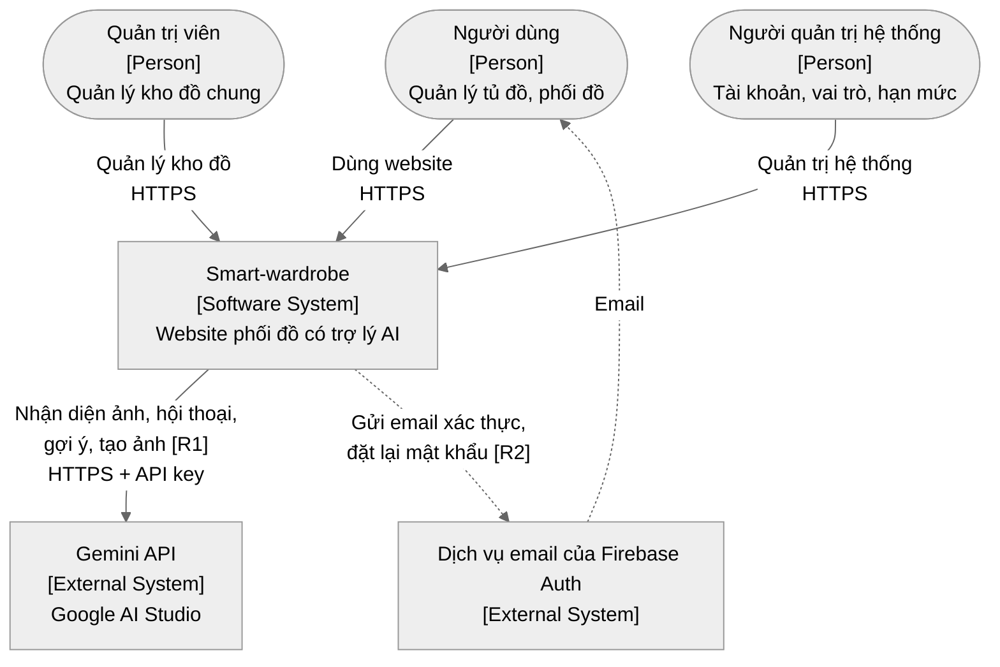

**Chú thích**

- **[R1]** Smart-wardrobe chỉ phụ thuộc một hệ thống AI bên ngoài là Gemini. Lời gọi luôn xuất phát từ phía server (Cloud Functions) và không bao giờ đi từ trình duyệt.
- **[R2]** Email do chính Firebase Authentication gửi, nên hệ thống không cần dịch vụ email riêng.
- Cả ba vai trò dùng chung một website. Điểm khác nhau chỉ là vai trò trong token đăng nhập (xem mục 5).

---

## 3. C4 mức 2: Container

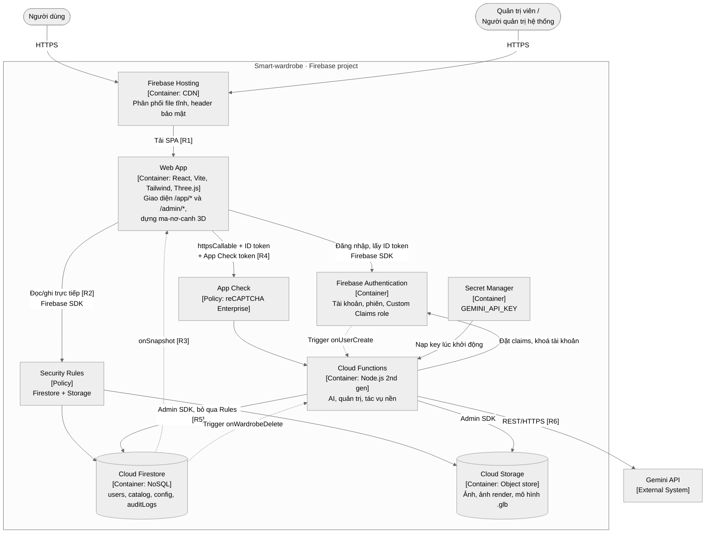

**Chú thích**

- **[R1]** Website là SPA tĩnh, không có server render. Hosting chỉ phân phối file và gắn các header bảo mật (CSP, HSTS…) theo [logic-he-thong.md](logic-he-thong.md) mục 12.
- **[R2]** Trình duyệt đọc/ghi Firestore và Storage **trực tiếp** qua SDK. Mỗi request phải qua Security Rules. Rules kiểm tra `uid` và `role` trong token, cùng danh sách trường được phép ghi.
- **[R3]** Đồng bộ thời gian thực giữa các tab và thiết bị dùng listener `onSnapshot` của Firestore. Không có WebSocket server riêng (ADR-002).
- **[R4]** Mọi lời gọi function đều mang hai token: ID token (ai đang gọi, vai trò gì) và App Check token (có đúng là website thật đang gọi không).
- **[R5]** Functions dùng Admin SDK nên **không** bị Rules chặn. Vì vậy mỗi function phải tự kiểm tra quyền (xem mục 5). Đây là nơi duy nhất ghi các trường nhạy cảm: kết quả AI, `role`, `status`, `usage`, `auditLogs`.
- **[R6]** API key chỉ tồn tại trong bộ nhớ của function đang chạy.

---

## 4. C4 mức 3: Thành phần Cloud Functions

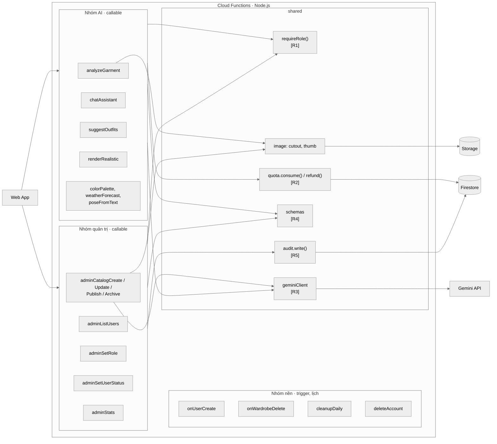

**Chú thích**

- **[R1]** `requireRole(minRole)` chạy đầu tiên trong mọi callable. Hàm kiểm tra theo thứ tự: có `auth` → tài khoản `active` → `role` đủ cấp. Nhóm AI yêu cầu `user`, `adminCatalog*` yêu cầu `admin`, `adminSetRole`/`adminSetUserStatus` yêu cầu `sysadmin`.
- **[R2]** Hạn mức được trừ trong một Firestore transaction **trước** khi gọi Gemini, và được hoàn lại nếu Gemini lỗi. Kèm theo là khoá `aiRequests/{requestId}`, nên bấm hai lần không bị tính hai lượt.
- **[R3]** `geminiClient` là nơi duy nhất biết API key. Nó đọc tên model từ `config/models`, thử lại tối đa 2 lần với lỗi tạm thời, và ép đầu ra theo JSON schema.
- **[R4]** Frontend và functions dùng cùng một bộ schema (`shared/schemas`), để kiểm tra dữ liệu đầu vào ở cả hai phía.
- **[R5]** `audit.write()` được gọi trong cùng transaction với thay đổi. Nếu không ghi được log thì thay đổi cũng không xảy ra.

---

## 5. Phân quyền: luồng kiểm tra quyền

Sơ đồ hoạt động (UML Activity) cho **mọi** request vào hệ thống:

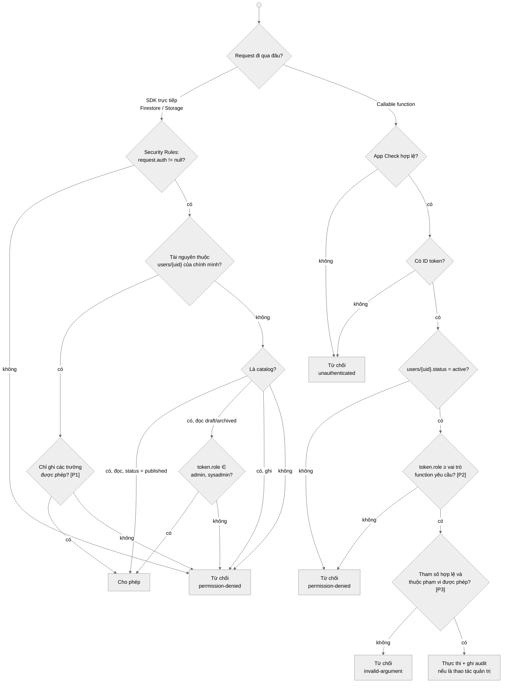

**Chú thích**

- **[P1]** Rules dùng `diff().affectedKeys().hasOnly([...])`. Ví dụ người dùng chỉ được sửa các trường hồ sơ, không bao giờ được sửa `role`, `status` hay `usage`.
- **[P2]** Thứ tự vai trò: `user` < `admin` < `sysadmin`. Vai trò nằm trong Custom Claims của token, nên kiểm tra không tốn thêm lần đọc database.
- **[P3]** Function kiểm tra cả phạm vi dữ liệu. Ví dụ `itemId` phải thuộc tủ đồ của người gọi, `storagePath` phải nằm dưới `users/{uid}/`, sysadmin không được hạ vai trò của sysadmin cuối cùng.
- Bảng quyền đầy đủ: [phan-quyen.md](phan-quyen.md) mục 2.

---

## 6. Trình tự: Đăng nhập và route guard

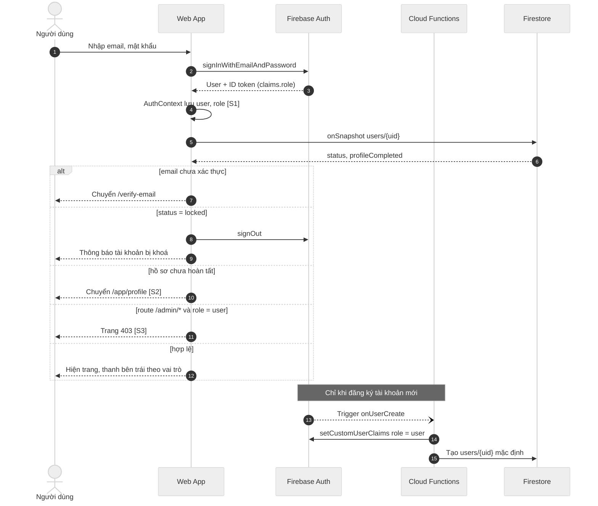

**Chú thích**

- **[S1]** `role` được đọc từ `getIdTokenResult().claims` và chỉ dùng để quyết định hiển thị. Quyết định quyền thật nằm ở Rules và Functions.
- **[S2]** Hồ sơ là trang đầu tiên sau khi đăng nhập, cho đến khi đủ trường bắt buộc (giới tính, chiều cao, cân nặng, dáng người).
- **[S3]** Frontend chặn để người dùng thấy thông báo rõ ràng. Nếu bỏ qua được frontend thì Rules và Functions vẫn từ chối.

---

## 7. Trình tự: Nhận diện ảnh quần áo

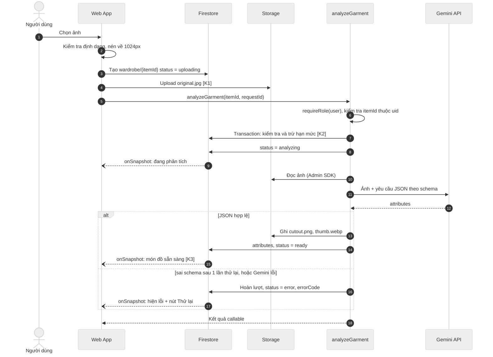

**Chú thích**

- **[K1]** Storage Rules chỉ cho ghi vào `users/{uid}/…` của chính mình, với `contentType` là ảnh và kích thước ≤ 5 MB.
- **[K2]** Transaction đọc `usage`, so với `config/quotas` hoặc `quotaOverride`, rồi tăng bộ đếm. Vượt hạn mức thì trả `resource-exhausted` và không gọi Gemini.
- **[K3]** Giao diện cập nhật nhờ `onSnapshot`, không phụ thuộc kết quả callable. Người dùng có thể rời trang trong lúc AI đang xử lý, quay lại vẫn thấy đúng trạng thái.

---

## 8. Trình tự: Gợi ý phối đồ và ma-nơ-canh

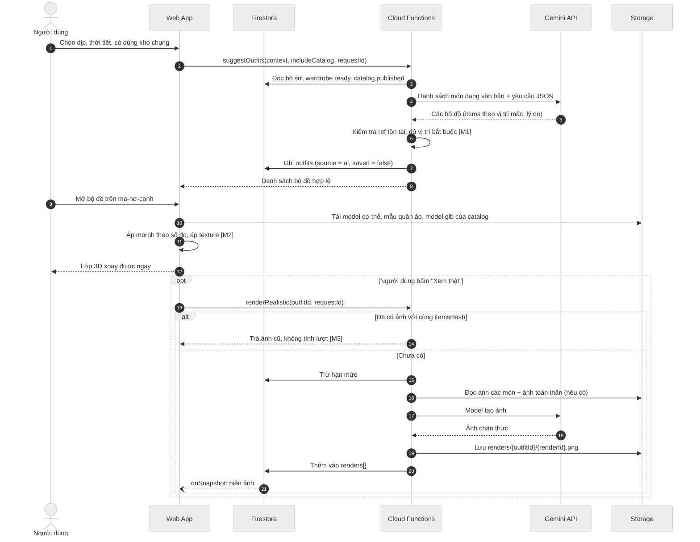

**Chú thích**

- **[M1]** Kết quả của Gemini luôn bị coi là dữ liệu không tin cậy. Bộ nào tham chiếu món không tồn tại, hoặc thiếu áo + quần / váy liền, đều bị loại.
- **[M2]** Lớp 3D chạy hoàn toàn trên trình duyệt và không tốn lượt AI. Món trong kho chung có `model.glb` riêng nên hiển thị giống thật hơn. Món còn lại dùng mẫu dựng sẵn phủ texture từ `cutout.png`.
- **[M3]** `itemsHash` là hash của danh sách món trong bộ đồ. Bộ đồ không đổi thì không tạo lại ảnh, giúp tiết kiệm chi phí.

---

## 9. Trình tự: Quản trị viên thêm quần áo vào kho chung

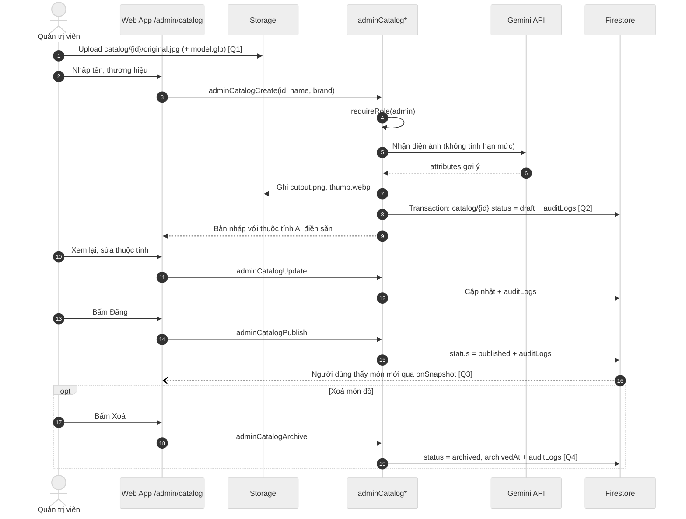

**Chú thích**

- **[Q1]** Storage Rules chỉ cho token có `role` là `admin` hoặc `sysadmin` ghi vào `catalog/**`.
- **[Q2]** Mọi thay đổi trong kho chung và bản ghi audit được ghi chung một transaction.
- **[Q3]** Người dùng chỉ đọc được bản `published`. Bản `draft` không bao giờ lộ ra ngoài.
- **[Q4]** Xoá là ẩn trong 30 ngày (ADR-006). `cleanupDaily` xoá hẳn sau thời hạn đó. Trong 30 ngày, sysadmin có thể khôi phục.

---

## 10. Trình tự: Người quản trị hệ thống đổi vai trò

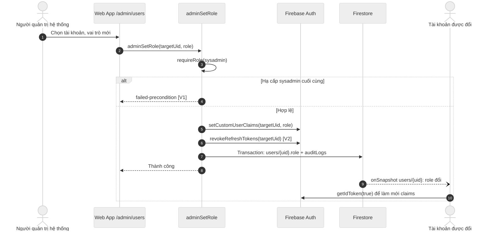

**Chú thích**

- **[V1]** Hệ thống luôn còn ít nhất một sysadmin. Sysadmin đầu tiên được tạo bằng script `scripts/grant-role.mjs`, không qua giao diện.
- **[V2]** Thu hồi token để quyền mới có hiệu lực ngay, không phải chờ token cũ hết hạn sau 1 giờ. Khoá tài khoản (`adminSetUserStatus`) đi theo trình tự tương tự, thêm bước `disabled: true`.

---

## 11. Máy trạng thái của dữ liệu

### 11.1 Món đồ trong tủ đồ cá nhân

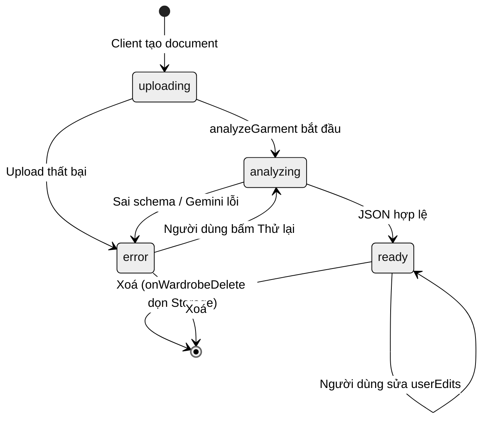

### 11.2 Món đồ trong kho chung

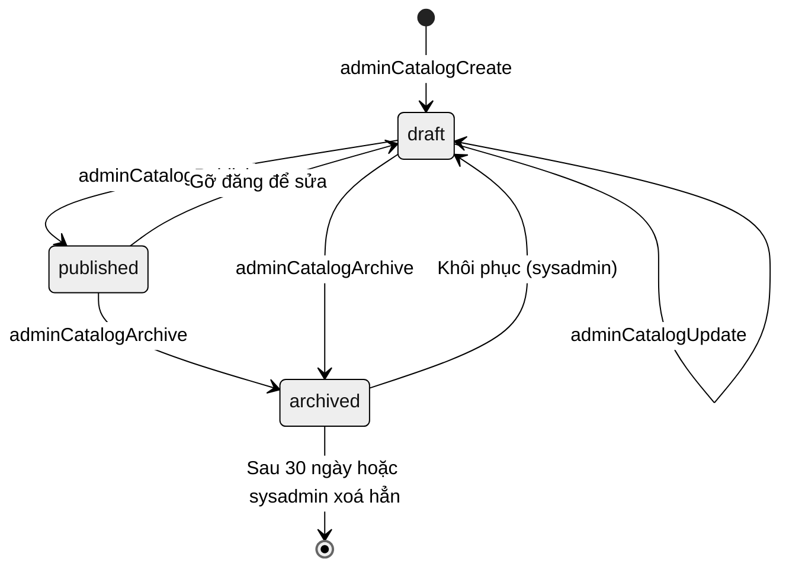

**Chú thích:** chỉ trạng thái `ready` (tủ đồ) và `published` (kho chung) được đưa vào gợi ý phối đồ và trợ lý AI.

---

## 12. Triển khai (Deployment)

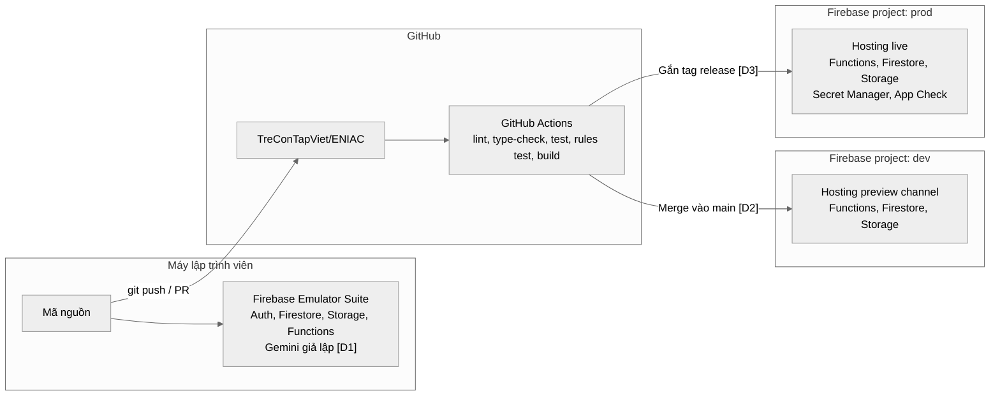

**Chú thích**

- **[D1]** Khi chạy test, Gemini được giả lập để kết quả ổn định và không tốn chi phí. Chỉ khi chạy thử thủ công mới gọi Gemini thật bằng key trong `functions/.secret.local`.
- **[D2]** Mỗi lần merge vào `main`, hệ thống tự triển khai lên project `dev` để kiểm thử.
- **[D3]** Production chỉ triển khai khi gắn tag. `dev` và `prod` dùng API key và dữ liệu riêng biệt.
